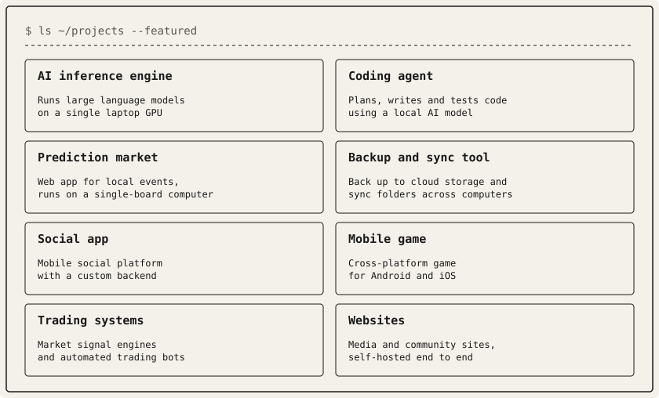
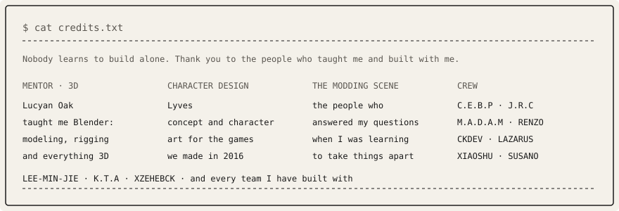

### About

Started taking games apart on a Core 2 Duo in 2011 to see how they worked. Never stopped building. Everything I run is self-hosted, on hardware I own.

- **2011** — Reverse engineering browser and PC games on a 4 GB Core 2 Duo. Learned to read a system instead of just using it.
- **2013** — Moved from breaking games to understanding how they defend themselves.
- **2015** — Self-taught coding by reading, testing and building. First apps written on a phone.
- **2016–2018** — Founded Sasori Ltd, shipped games for the Chinese market. Later shipped WILD HAT with EC Technologies and Liki Studios.
- **2017–now** — Building automated trading systems and market signal tools.
- **2019–now** — Founded Ytteria Studios, a white-hat security group with researchers across five countries.
- **Now** — Running my own AI models, building products and shipping code every day.

### What I build

I build things across games, AI, web, mobile and security. My work ranges from inference engines that run large language models on a single GPU, to prediction markets, coding agents, backup tools, CMS platforms, and trading bots. I pick the right tool for the job and learn whatever is needed to ship.

### Journey

### Projects

### Credits

