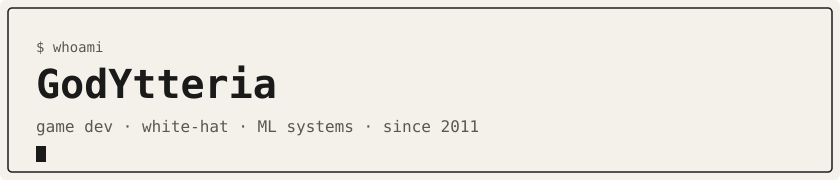
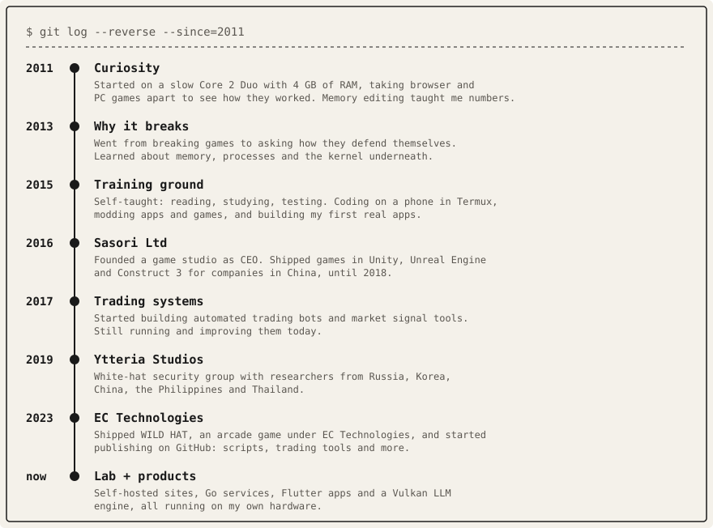
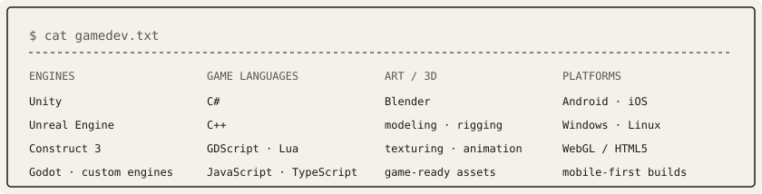
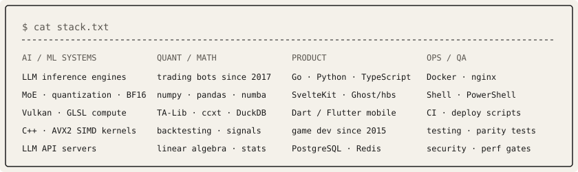
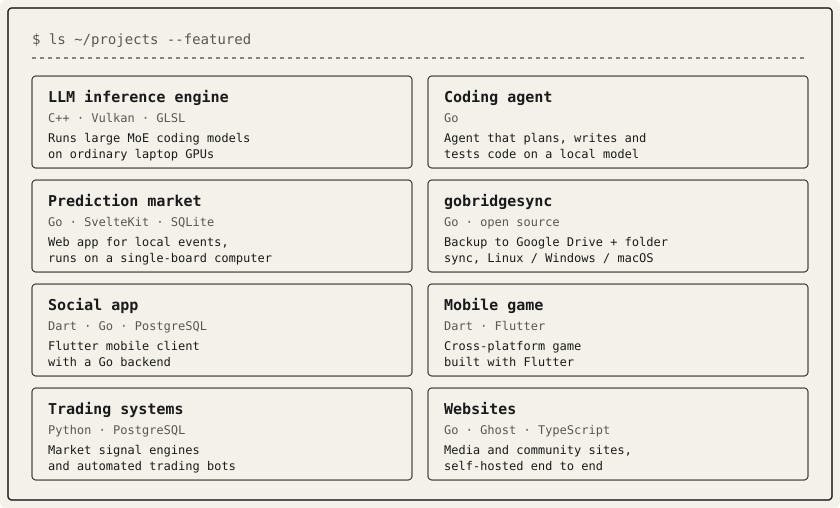
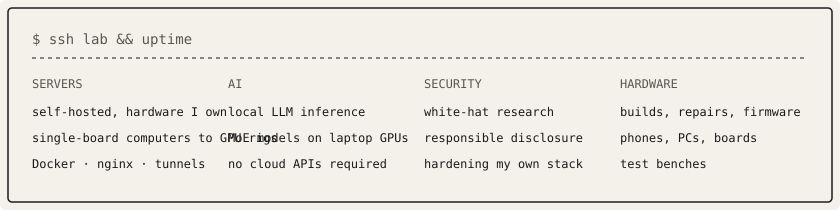
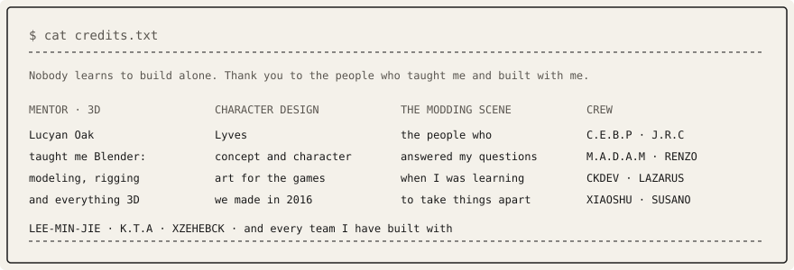

### About

It started around 2011 on a slow Core 2 Duo, taking games apart just to see how they worked, and I never stopped building. Everything I run is self-hosted, on hardware I own.

- **Curiosity · 2011** — My first computer was a Core 2 Duo with 4 GB of RAM. I spent it modding and reverse engineering browser and PC games, editing memory to see what each number did. That is where I learned to read a system instead of just using it.
- **Why it breaks · 2013** — Breaking games turned into the better question: how do they defend themselves? That pulled me into memory, processes and the kernel, and into protecting my own games later on.
- **Training ground · 2015** — Taught myself to code by reading, studying and testing everything. Wrote code on my phone in Termux, modded apps and games, and built my first apps.
- **Sasori Ltd · 2016–2018** — My first studio, founded as CEO, building games for companies in China. We shipped in Unity, Unreal Engine and Construct 3, mostly in C# and C++. Lyves turned my original character concepts into the art that shipped.
- **Studios · 2016–now** — I have started several small studios over the years, each one a different experiment. Sasori Ltd made games for the Chinese market; EC Technologies shipped WILD HAT, a mobile arcade game, with Liki Studios. Different names, same habit: build it, ship it, learn from it.
- **Trading systems · 2017–now** — Designing and running my own automated trading bots and market signal tools.
- **Ytteria Studios · 2019–now** — A white-hat security group with researchers from Russia, Korea, China, the Philippines and Thailand, working together to find and fix vulnerabilities.
- **The lab** — My own hardware and software lab, where I work across the whole stack: hardware, firmware, GPU kernels and local LLM inference.
- **Self-hosted everything** — My sites, services and AI models run on my own servers, not someone else's cloud.

### Journey

### Game development

### Stack

### Projects

### The lab

### Credits

