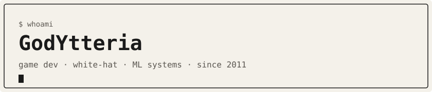
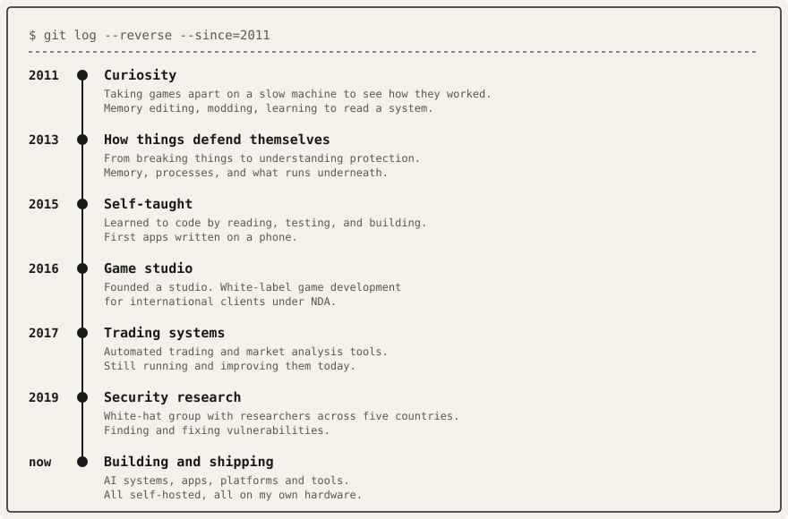

### About

Self-taught developer since 2011. Started by taking games apart on a Core 2 Duo to see how they worked. Went from modding to building games, trading systems, web platforms, mobile apps and AI tools. Everything I ship runs on my own hardware.

Most of my work is white-label and under NDA. Some of my earlier open-source tools and scripts were published on modding and security forums where the community lived. What you see here is the newer side of my work.

### What I do

- Games, apps and web platforms for private clients
- AI and inference systems that run locally on a single GPU
- Automated trading and market analysis tools
- Security research and vulnerability testing

### Journey

### Projects

### Credits

